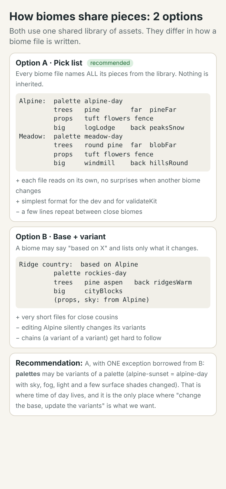

# Pocket Links: art style guide (living document)

Owner: the Artist, with Alexis (owner / game designer). Status: **ART0a (biome-set concept, #73) and ART0b (the general style, round 2) decided by the owner.** Anything marked **(owner)** is decided; anything marked *proposal* still needs a yes. Images: `docs/art/style-r2/` (the style), `docs/art/biome-sets/` (round 1 structure).

> Round 2 images are mock-ups of the style, rendered on a stand-alone test hole. The golfer in them is a grey-box stand-in that only shows the chibi proportions, not a character design. **No real assets are made yet** (nothing under `assets/`); asset work starts from this guide.

— Agent: artist

## 1. Art direction (owner, 2026-11-19)
- **3D, cartoony, low-poly, bright.** Flat colours **with a stylised texture** (speckles, light brush dabs, ripples), never photo-realistic, no realistic trees.
- **Direction B, "Sunny postcard" (owner, round 2):** **colours that pop** on **places that could be real**. The colour and readability of a bright cartoon golf game, on believable settings: snowy peaks, hills with a windmill, a sea coast, later canyons or a city skyline. **No fantasy props** (no candy hills, giant cakes, mushrooms, character topiary).
- Owner's references (round 2): Mario Golf: World Tour courses for the colours, the clear theme per course and how the course sits in the landscape; Hot Shots / Everybody's Golf for the believable settings. **Learn the idea, copy no look:** no model, tree shape, layout, character or branding from any game or real course. Real places are inspirations only, with invented names.
- Disliked (owner): **muted, greyish colours**; semi-realistic trees.
- The **pixel / PS1 effect is a player setting, off by default** (owner). Every asset must read well clean and pixelated.

### 1.1 Style rules (owner, round 2)
| Topic | Rule |
|---|---|
| **Shapes** | **Soft and round** (owner: 1a). Round canopies made of 2-3 overlapping low spheres, pines as stacked tiers with a rounded shoulder and a drooping skirt, rounded bushes. Low-poly but not spiky: the silhouette is soft, the facets are small. |
| **Shading** | **Toon shading, 3 bands** (light / mid / shadow) from the sun, plus a soft sky light. Models get a **vertical gradient**: light top (`leafTop`), mid (`leaf`/`pine`), dark bottom (`leafLow`). Never pure black shadows. |
| **Texture** | **Between "barely there" and "brush dabs"** (owner: 2 a+b): a fine speckle everywhere + a few light brush dabs, broad mowing stripes on the fairway, diagonal stripes on the green, soft larger darker patches in the rough. Greyscale textures recoloured by the palette (§4.3). |
| **Colour** | **Bright and sunny** (owner: 3b), saturated, deep blue sky fading to a pale horizon, big white clouds. **The biomes must differ clearly** (owner): each set gets its own hue family, not only another backdrop (see §6.1). |
| **Outlines** | **On the golfer only** (owner), a thin dark slate line (`#24343c`, not black), inverted hull. None on the course, trees, props or backdrop (they turn the far forest dark and add ~40 % triangles, image 02). The ball, flag and markers may get one later if playtests ask for it. |
| **Course readability** | A **crisp darker edge line** (`edge`, ~0.6 m) around the fairway, tee and fringe; bunkers in cream sand with a darker **lip**; water with a deep-to-light gradient, **sparkle ripples** and a **bank** (dirt, or sand on the coast). Soft tree shadows painted into the ground under every on-course tree. |
| **Trees** | Stylised, never realistic. 2-3 models per biome, mixed sizes. A packed **wall of treetops** at the back (cheap model, fading into the fog) frames the hole. |
| **Sky and backdrop** | One gradient dome + round, flat-bottomed puffy clouds. Backdrops are believable silhouettes (peaks with snow caps, round hills, a sea horizon with an island), tinted, base fading into the fog (tint-only, owner). |
| **The land** | The course sits **in** the landscape: the ground rises beyond OB into a bowl of hills and forest, raised greens, rock faces, a beach or creek alongside. (Mostly the course designer's job: the artist supplies the pieces.) |
| **UI feel** | Clean, friendly, rounded (pill labels, soft shadows). The HUD and menus belong to the UI designer (`docs/UI.md`); the HUD keeps the only neon colours. |

### 1.2 The golfer (owner, round 2)
- **Chibi:** the **head is about 1/3 of the body height** (~1.45 m tall golfer, head ~0.55 m across). Big head, short body and legs, simple hands. Toon shaded like the course, **with the golfer outline**.
- **Standard skeleton rule (all golfers):** every golfer model uses **one standard humanoid skeleton with Mixamo-compatible bone names** (`mixamorig:Hips`, `Spine`, `Spine1`, `Spine2`, `Neck`, `Head`, `LeftShoulder`/`LeftArm`/`LeftForeArm`/`LeftHand`, the same for `Right`, `LeftUpLeg`/`LeftLeg`/`LeftFoot`/`LeftToeBase`, the same for `Right`; finger bones optional), the same rest pose (T-pose), the same scale (1 unit = 1 m) and facing +Z, with the root at the feet. **All animations are made once on this skeleton** and shared by every golfer; a new golfer = a new mesh skinned to the same bones. The big head is done by the **mesh and the Head bone's position**, never by scaling bones inside animations. Right-handed by default; left-handed is a mirror (BC). ≤ 60 bones, ≤ 3k triangles (PS1) / ≤ 8k (clean), ≤ 2 materials.
- A **soft round shadow** under the golfer and the ball (no real-time shadows, phone budget).
- Placement: a right-handed golfer stands left of the ball; the aiming camera must keep the aim line, the landing marker and the flag visible ("no blind shots", AP9a).

### 1.3 Pixel setting (owner, round 2)
**Off by default** (owner). *Proposal:* when the player turns it on it renders at **50 %** of the screen resolution (image 03: the course still reads, the golfer and treetops get a soft retro edge), with **33 %** as an extra "retro" step (far trees and aim dots start to break up). Built by the dev in AP8.

### 1.4 Do / don't (owner, round 2)
| Do | Don't |
|---|---|
| Soft round silhouettes, small facets, toon shading in 3 bands | Spiky or jagged low-poly, flat single-colour blobs |
| Light top / dark bottom gradient on every tree and bush | Pure black outlines or shadows (use the palette's `shadow`) |
| Saturated, sunny colours; a deep blue sky with big white clouds | Muted, greyish or washed-out colours |
| Believable places: peaks, hills, coast, lodges, windmills | Fantasy props (candy, giant food, mushrooms, character topiary) |
| A crisp darker edge around fairway, tee and green; cream bunkers with a lip | Fuzzy edges where the player can't tell fairway from rough |
| Fine speckle + light brush dabs, from greyscale textures | Photo textures, normal maps, realistic bark or leaves |
| Keep the course brighter and more saturated than the backdrop | A backdrop brighter or busier than the fairway |
| Outline the golfer only | Outlines on the course, trees or far scenery |
| Give each biome its own colour family | Four biomes that are the same green with another backdrop |
| Copy ideas, not looks | Any model, tree shape, layout or character copied from a game |

## 2. What a biome set is (owner, DESIGN §8b)
A **file that defines a biome**, which the **course designer applies to a hole** (per hole, owner). It holds:

| Piece | What | Where it comes from |
|---|---|---|
| Description | one short paragraph | the biome's own |
| Palette | colours of every surface, water, trees, sky, fog, light, backdrop, props (one palette per set: the time of day is part of it) | the biome's own |
| Course textures | fairway, green, rough, sand, water, rock… | **the same for every biome**, recoloured by the palette |
| On-course trees | 2-3 models, recoloured; collisions stay in the hole data | picked from the library |
| Off-course trees | 2-3 cheaper models, recoloured | picked from the library |
| Skybox | one gradient sky + clouds, recoloured | the same for every biome |
| Small props | tufts, flowers, fences spread in the rough, no physics | picked from the library |
| Big props | lodges, windmills, huts, city blocks, mostly out of bounds, no physics | picked from the library |
| Backdrop | far scenery (peaks, hills, sea), recoloured where the asset allows | picked from the library |
| Gameplay notes | advice for the course designer, may suggest a weather | the biome's own |

**Not in a biome set:** weather (per playlist), a time-of-day system (a sunset is its own biome set, see 4.2), physics (`surfaces.js` and the hole data), the HUD.

## 3. How biomes share pieces: a pick list (owner, #73)
Both options keep **one shared library** (`assets/`, one copy of each model, texture and backdrop). A biome file only names pieces.

- **Option A, pick list (recommended):** every biome file names all its pieces. Nothing is inherited. Easy to read, easy to validate, no surprise when another biome changes. Cost: a few repeated lines between close biomes.
- **Option B, base + variant:** a biome says "based on X" and lists only what it changes. Very short files for close cousins, but editing the base silently changes every variant, and chains get hard to follow.
- **Decided (owner, #73): option A, the pick list.** There are **no palette variants** and no inheritance anywhere: every biome set names all its pieces and has its own full palette. Other owner decisions on #73: backdrops are **tint-only** for now; **big props are placed by hand** per hole by the course designer; **small props are scattered by a rule** from the biome set; the names Meadow, Alpine, Island coast are internal.

## 4. Palette rules
### 4.1 Keys every palette defines (same keys in every palette)
- **Surfaces:** `tee`, `fairwayA`/`fairwayB` (mowing stripes), `edge` (the darker edge line, round 2), `fringe`, `greenA`/`greenB`, `rough`, `deepRough`, `sand`, `lip` (bunker rim, round 2), `water`, `waterDeep`, `bank` (water bank, round 2), `rock`, `path`.
- **Sky / fog / light:** `skyTop`, `skyHorizon`, `cloud`, `fog`, `sun` (sun tint), `ambient` (sky light), `shadow` (shadow tint, the hemisphere ground colour: never black).
- **Backdrop tint:** `backFar`, `backNear`, `backCap` (snow / tops), `backCapShade`, `backTrees` (the wall of treetops, round 2).
- **Accents (owner, 2026-11-19):** `accent` (the **flag** and the biome's main signature touch) and `subAccent` (tee markers, flower beds, prop trims, signs). Small things only, never a surface. The biome's signature colours.
- **Trees and props tint:** `pine`, `trunk`, `leafTop`/`leaf`/`leafLow` (light top, mid, dark bottom: round 2), `leafAlt`, `trunkAlt`, `wood`, `roof`, `propSnow` (light parts), `propA`/`propB` (flowers), `glass`.
- The **round 2 palettes** (§4.5) replace the round 1 examples (`docs/art/biome-sets/draft-data.js`, kept for history).

### 4.2 Time of day = its own biome set (owner, #73)
**Alpine** and **Alpine sunset** are **two biome sets**: the same pick list of pieces, each with its own complete palette. There is no lighting engine and no "variant of" link between palettes: the sunset palette simply has its own sky gradient, fog, sun and ambient tint, shadow tint, backdrop tint (pink caps) and warmer surfaces. It must pass every readability rule below on its own. **The hole chooses the biome set; the playlist chooses the holes** (weather stays per playlist). Tip for the artist: start a sunset palette by copying the day palette's values, then change them; after that the two are independent (editing one never changes the other).

### 4.3 How the backdrop and models are recoloured
- **Backdrops** are built in **tint zones**: far layer, near layer, caps, cap shade. Each zone takes one palette colour, then is **mixed toward `fog`** by its distance (far layer about 40 %, near layer about 20 %). So one snowy-peaks asset works for day and sunset with no new art.
- **Models** (trees, props) use **material slots** named after palette keys (`canopy → pine`, `trunk → trunk`, `walls → wood`, `roof → roof`). Slots are flat colours; light and shade come from the sun / ambient / shadow tints. A model may have a fixed-colour slot only for something that never changes (a window frame).
- **Textures** are **greyscale**: they hold only the pattern (dabs, speckles, ripples, stripes). The palette gives the colour. One set of 10 textures serves every biome (image 04).

### 4.4 Readability rules (gameplay rule: no blind shots)
Checked automatically on every palette sheet (CIE76 ΔE = colour difference, ΔL = lightness difference, which is what colour-blind players and the pixel effect keep):

| Pair | ΔE at least | ΔL at least |
|---|---|---|
| fairway / rough | 15 | 8 |
| green / fairway | 10 | 5 |
| green / rough | 20 | 10 |
| sand / fairway | 20 | 10 |
| sand / rough | 30 | 15 |
| water / fairway, rough, green | 30, 25, 30 | - (water must also have its ripple texture and an edge) |
| aim yellow `#FFD447` on fairway | 20 | |
| warning red `#FF4A3A` on rough | 30 | |
| white aim dots on fairway | 15 | |
| flag `accent` on green (both shades), rough, fairway, sky top and horizon | 30 | |
| `accent` vs HUD warning red `#FF4A3A` and aim yellow `#FFD447` | 15 | (a flag must never look like a warning) |
| `subAccent` on green, rough and sky horizon | 30 | |

Also: the course is always lighter and more saturated than the backdrop; no surface may use the HUD's yellow or red; the putting grid (when shown) must stay visible on both green shades. All four palettes in this round pass. Known weak spot: warning red vs rough has almost no lightness difference (ΔL 1-5), so red/green colour-blind players need the warning's **shape** too (ask: UI designer).

### 4.5 Palettes, direction B (owner: "I love the colours", round 2)
Data: `docs/art/style-r2/palettes.js` · sheet: `docs/art/style-r2/06-palettes.jpg`. All four pass every rule in §4.4. Golden-hour Alpine sunset is its own biome set (§4.2). These are the **starting palettes**: the owner wants the biomes to vary more, so each will move further into its own colour family when its kit is built (§6.1), always re-checked against §4.4.

| Key | Meadow | Alpine | Alpine sunset | Island coast |
|---|---|---|---|---|
| `tee` | `#8DE05A` | `#86DD6C` | `#7ED668` | `#90E85C` |
| `fairwayA` | `#88DA4E` | `#80D964` | `#7AD25E` | `#8CE652` |
| `fairwayB` | `#79CC42` | `#70CB57` | `#6AC452` | `#7CD846` |
| `edge` | `#4E9F2E` | `#3F9A3E` | `#3E8A44` | `#3FA036` |
| `fringe` | `#7DD04A` | `#76D05E` | `#70CA58` | `#82DC4C` |
| `greenA` | `#B6F57C` | `#B2F590` | `#ACEE84` | `#BCFA86` |
| `greenB` | `#AAF06C` | `#A6EF82` | `#A0E878` | `#B0F676` |
| `rough` | `#4CAA36` | `#3FA64E` | `#3C9650` | `#40B43E` |
| `deepRough` | `#3A942E` | `#2F8C46` | `#2E7C48` | `#319C3A` |
| `sand` | `#FFF0C2` | `#FAF3DC` | `#FFE6C4` | `#FFF5D8` |
| `lip` | `#C9B27A` | `#BFB79A` | `#C2A48C` | `#D6C496` |
| `water` | `#2C8FE3` | `#1FA2EA` | `#4A86E0` | `#18C6E2` |
| `waterDeep` | `#1C66C2` | `#1474C9` | `#3A5CB8` | `#0B8ED2` |
| `bank` | `#9C7A4E` | `#8C8070` | `#8E6A58` | `#F2E2B4` |
| `rock` | `#A89B8E` | `#A4ABB6` | `#B49CA4` | `#5E5866` |
| `path` | `#E9D9AE` | `#DCD3BE` | `#E6C9B0` | `#EEDDB4` |
| `skyTop` | `#1877E8` | `#156BE0` | `#3A4FB6` | `#0C82F0` |
| `skyHorizon` | `#BDEAFF` | `#C8EEFF` | `#FFB26E` | `#C6F4FF` |
| `cloud` | `#FFFFFF` | `#FFFFFF` | `#FFD8BC` | `#FFFFFF` |
| `fog` | `#CBEBFF` | `#D0EDFF` | `#FFC79E` | `#CCF2FF` |
| `sun` | `#FFF4DA` | `#FFF6E6` | `#FFC48A` | `#FFF8E4` |
| `ambient` | `#E8F5FF` | `#E4F2FF` | `#E8D4E8` | `#EEFAFF` |
| `shadow` | `#2F7A4A` | `#2C6A6A` | `#4E4A8E` | `#2A7A70` |
| `backFar` | `#7FB0D6` | `#6F96D2` | `#8C74B4` | `#4E9E86` |
| `backNear` | `#58A85A` | `#4E7FBE` | `#6E5EA6` | `#3E9A5E` |
| `backCap` | `#8CC96A` | `#FFFFFF` | `#FFC9B4` | `#7ECB92` |
| `backCapShade` | `#6DB458` | `#C6DAF4` | `#C79CC4` | `#5EB07C` |
| `backTrees` | `#3E9A44` | `#25784E` | `#3D5E52` | `#2E9446` |
| `pine` | `#23885A` | `#1F8457` | `#2E7650` | `#2A8A50` |
| `trunk` | `#8A5634` | `#7A4C2E` | `#7A4630` | `#8E6A46` |
| `leaf` | `#3DB04A` | `#2FA052` | `#4A9248` | `#3CB648` |
| `leafTop` | `#8EE05C` | `#5FC56E` | `#A9C860` | `#8CE45A` |
| `leafLow` | `#24803C` | `#145E44` | `#2A5444` | `#1F7E3E` |
| `leafAlt` | `#69C83A` | `#1E9C86` | `#3E8A70` | `#3ECB52` |
| `trunkAlt` | `#A87A4E` | `#8A5A38` | `#8A5638` | `#C49A68` |
| `wood` | `#D08B4C` | `#BE7440` | `#C77A44` | `#D2A262` |
| `roof` | `#E0533E` | `#C9483A` | `#B8453E` | `#E8C068` |
| `propSnow` | `#FFFFFF` | `#FFFFFF` | `#FFE6D8` | `#FFFFFF` |
| `propA` | `#FF5C8E` | `#FF6FA0` | `#FF7C9A` | `#FF5E94` |
| `propB` | `#FFD83A` | `#FFE04A` | `#FFD45A` | `#FFD02E` |
| `glass` | `#BFE6FF` | `#CBE9FF` | `#FFD6A0` | `#CFF4FA` |

**Accents (owner: "good for now", 2026-11-19)** · image `07-accents.jpg`. All pass the accent rules in §4.4 (flag vs green ≥ 114, vs sky ≥ 54, vs HUD red ≥ 33).

| Biome set | `accent` (flag) | `subAccent` | Why |
|---|---|---|---|
| Meadow | `#D91E5B` poppy pink-red | `#FF9A1F` marigold | wildflower field |
| Alpine | `#B8143C` deep mountain red | `#3550D8` gentian blue | red roofs, blue mountain flowers; darker than the HUD warning red |
| Alpine sunset | `#B0207E` magenta | `#FFB21E` golden | reads on the orange sky, golden hour |
| Island coast | `#FF2E8A` hibiscus pink | `#FF7A1A` mango orange | tropical flowers and fruit |

All palettes (accents included) are **starting values**: every biome gets a full pass with the per-biome process (§6.2) once biome-set support (AP5) is on main (owner).

## 5. Phone budget for art (from `reviews/art-tech-lead-followup.md`)
- Tree / rock model **≤ 300-500 triangles** (our models: 100-250), far trees ≤ 50, ≤ 8 tree/rock types per biome.
- Big prop ≤ 1,500 triangles; small prop ≤ 50 (or a flat sprite).
- Textures small and stylised: tiling ground textures **256² (max 512²)**, greyscale.
- Draw calls ≤ 150 per frame: every tree, small prop and far tree type is **instanced** (one call per model part).
- Download per course ≤ 8 MB; graphics memory per hole ≤ 64 MB. No transparent leaves; solid canopies.

## 6. The three starter biomes
| Biome | Palette mood | Trees (on / off) | Big props | Backdrop | Gameplay notes |
|---|---|---|---|---|---|
| **Meadow** (grassland) | warm classic greens, red roofs, pink flowers | round leafy + pine / blobFar + pineFar | windmill | soft round hills | gentle slopes, ponds, open fairways; any weather |
| **Alpine** (mountain) | cool fresh greens, pale sand, blue water (plus a separate **Alpine sunset** set) | pine / pineFar | log lodge | snowy peaks | creeks, raised tees, elevation; clear, light wind |
| **Island coast** (beach, Hawaii-like) | bright tropical greens, white sand, turquoise sea | palm + round leafy / palmFar + blobFar | beach hut | sea + green volcano | the sea along one side, waste bunkers, dark lava rock; sunny, sea wind |

### 6.1 Make the biomes differ more (owner, round 2)
Round 2's palettes are all "sunny green"; the owner loves them but wants each biome to feel more distinct. Direction for the kit work (*proposal*, each shown to the owner when built):
- **Meadow:** warm yellow-greens, red roofs, pink and yellow flowers, soft blue hills. The friendly default.
- **Alpine:** cool blue-greens, teal pines, white snow, red lodge roofs, glacier-blue water.
- **Alpine sunset:** golden light, violet shade, pink snow caps, warm sand.
- **Island coast:** the most saturated: lime greens, white sand, turquoise sea, dark lava rock, palms.
Rule: the **fairway stays the lightest green in every biome** (gameplay), so the identity comes from the rough, trees, sky, backdrop, water and props.

**Why Alpine for the mountain:** the snowy peaks are the strongest contrast with the Meadow (a different silhouette, not just another green), the existing mountain course already uses pines, and its sunset set shows the palette-only time of day best. **Ridge country** (Rockies-like: warm palette, aspens, long ridges, far city) stays a *later idea*: it would reuse everything of Alpine except the palette, one tree, the backdrop and one big prop (image 14), which is exactly the owner's mix-and-match example.

Later examples (desert, city park, sea cliffs, Georgia pines…) reuse the same library: mostly a new palette plus 1-3 new pieces each (image 03).

### 6.2 How each biome set is made (owner, round 2)
One biome set per artist session, always in this order:
1. **Mood board (owner):** Alexis shares pictures and a few words for this biome (places, games, photos, colours, props).
2. **Notes + library check (artist):** the artist sums up what he takes from it and lists, piece by piece (palette, ground textures, on-course trees, off-course trees, sky, backdrop, small props, big props), what **reuses the shared library** and what is **new** (with a rough triangle / size cost against the budget in §5).
3. **Proposals (artist):** palette sheet + phone-size mock-ups on a test hole, 2-3 options where there is a real choice, with a recommendation. Every palette passes §4.4.
4. **Approval (owner):** Alexis approves each element (palette, trees, backdrop, props, gameplay notes) or asks for changes. Nothing is final without his yes.
5. **Record + build:** the approved set is written down (its pick list, palette, notes) and only then are the new assets made, each recorded in `assets/CREDITS.md`.

### 6.3 Meadow (ART1, owner-approved 2026-11-20): the default theme
**The default, classic theme** (owner): the one players see most and the base the other biomes stand out from. Mood board (owner): a stereotypical video-game meadow park, **lots of trees**, **green but not neon, warmer** grass, **buttercup yellow** in the flowers, **windmills and cows, no barns** ("this is not a farm"). His palette strip: dark green `#376643`, mid `#6A9B4E`, lime `#A8CA5B`, cream `#F1E7CD`, brick red `#BC4749`.
- **Decided (owner):** palette **A "warm"** (not B "warmer": keep warmer greens for later biomes) with the **brick-red flag** `#BC4749` (it matches the windmill caps); tee markers buttercup yellow `#FFC21A`. Data: `src/biomes/meadow-day.js` (source `docs/art/meadow/palettes.js`), passes every §4.4 rule, no waiver. Images: `docs/art/meadow/01-05`.
- **Pieces** (✅ in the library today · 🔧 new, needs dev work first):

| Piece | Status | Notes |
|---|---|---|
| Palette | ✅ in `meadow-day` | warm yellow-greens, cream sand, brick-red accents |
| Hills backdrop, flag, tee markers, OB stakes, pond, boulders | ✅ reused | tinted by the palette |
| Soft round tree (3 blobs, light top / dark bottom), in play | 🔧 AP7 + gradient slots | ~270 tris; replaces `roundTree` |
| Tall soft conifer (cypress-like) | 🔧 AP7 | ~130 tris, `leafAlt` ramp |
| Round treetop wall (far trees) | 🔧 AP7 | ~80 tris, instanced, replaces `coneTree` |
| Buttercup patches, a few red flowers, grass tufts, bushes | 🔧 smallProps (weights + clusters) | ≤ 8-50 tris each; patches of ~10 flowers |
| Wooden windmill (4 white sails, brick-red cap) | 🔧 bigProps | ~400 tris, 1-3 per hole on the hills out of bounds |
| Cow, grazing (white with dark patches) | 🔧 bigProps | ~400 tris, a few behind a fence, never in play |
| Wooden fence (posts + rails) | 🔧 bigProps | ~24 tris per section |
| Gradient sky + puffy clouds; textured ground (speckle, edge line, lip, bank) | 🔧 AP6 / sky | as in §1.1 |

Budget: the mock-up's golfer view is ~320k triangles, of which ~100k is the mock-up's own dense terrain; the game's terrain (AP1b) is lighter, so the set fits the 300k line. Flowers must stay tiny (≤ 8 tris) or be sprites.

### 6.4 Alpine (ART1, owner-approved 2026-11-20): Swiss Alps
Mood board (owner): **a Swiss style, really the Alps**. The grass is **warm**, but there are **a lot of colder colours** too. **Prominent peaks** in the background, **mainly pines**, **Swiss chalets** as big props, **Swiss red** as the accent. Photos: Alpine courses under big snowy peaks, hay huts on rolling greens, a chalet village, a cable-car colour palette.
- **Decided (owner):**
  - palette **A "warm grass, cool world"** (not B "fresh and cooler", too close to Meadow)
  - **Swiss-red flag** `#C8102E` (only the colour: never a flag cross or real logos) and **alpine-gold tee markers** `#E0A82E`
  - **peaks:** stylised, Matterhorn-like **horn peaks** (invented): wide at the base, a leaning hooked summit, faceted blue-grey rock faces, snow on the summit and the ledges (owner: "not just a big triangle", then "wider")
  - **sky:** a **lighter azure** taken from his photos, `#5CB4F2` → `#B4E4FC` (he chose the lightest of four)
- **Data:** `src/biomes/alpine-day.js` (source `docs/art/alpine/palettes.js`). It passes every §4.4 rule with no waiver. Images: `docs/art/alpine/01-07`.
- **Pieces** (✅ in the library today · 🔧 new, needs dev work first):

| Piece | Status | Notes |
|---|---|---|
| Palette | ✅ in `alpine-day` | warm lime grass, blue-grey peaks, dark teal pines, Swiss red, gold |
| Flag, tee markers, OB stakes, pond, boulders | ✅ reused | tinted by the palette |
| **Horn-peaks backdrop** | 🔧 new backdrop piece | 1 hero horn + 5-6 smaller horns (5-6 sided, ~80 tris each) + a far ridge + dark forested slopes; tint zones `backFar` (rock), `backCap` (snow), `backNear` (slopes) |
| Soft pine (4 tiers), teal spruce (5 tiers), tall spruce, birch | 🔧 AP7 + gradient slots | ~320 / ~390 / ~130 / ~185 tris; shared with Meadow's conifer |
| Pine wall (far trees) | 🔧 AP7 | ~56 tris, instanced |
| White and blue wildflowers, grass tufts | 🔧 smallProps | same system as Meadow's buttercups (`propA` white, `propB` blue) |
| Swiss chalet (dark wood, white stone base, low grey roof, red shutters and geraniums from `accent`) | 🔧 bigProps | ~700 tris |
| Small chalet / hay hut | 🔧 bigProps | ~200 tris |
| Wooden fence | 🔧 bigProps | shared with Meadow |
| Gradient sky; textured ground | 🔧 AP6 / sky | as in §1.1 |

### 6.5 Island coast (ART1, owner-approved 2026-11-20): the Honolulu vibe
Mood board (owner): **beach, but not the Caribbean and not the US east or west coast: the Honolulu vibe**. **A lot wilder water and grass colours.** **The course follows the ocean.** **A couple of really tall palm trees as props.** **No lighthouse** here (owner: keep it for a future Cape Cod-like set). Palette strip: teal `#4AC2BE`, mint `#A3DFC8`, pale lime `#E5F0C2`, tropical orange `#F9AD64`.
- **Decided (owner):**
  - palette **B "wilder"**: electric lime grass, almost-neon cyan water `#00E0D8` → deep blue `#0090E8`, golden sand
  - **tropical-orange flag** `#FF8A2A` and **bougainvillea-magenta tee markers** `#E0309A` (owner: "great accents")
  - This set is deliberately the most saturated one: the "no neon on surfaces" rule (§1.4) is stretched here on purpose, and it still passes every §4.4 rule.
- **Data:** `src/biomes/island-day.js` (source `docs/art/island/palettes.js`), no waiver. The boulders are dark lava `#3e3a40` (since X27 the minimap test accepts boulders that pass without darkening). Images: `docs/art/island/01-05`.
- **For the course designer:** run the fairways along the beach, with the sea on one side; keep holes low, near sea level; use lava-rock edges and waste bunkers; add 1-3 very tall palms as landmarks.
- **Pieces** (✅ in the library today · 🔧 new, needs dev work first):

| Piece | Status | Notes |
|---|---|---|
| Palette | ✅ in `island-day` | wild lime, cyan shallows, deep blue, golden sand, lava rock |
| Flag, tee markers, OB stakes, pond, boulders | ✅ reused | tinted by the palette |
| **Ocean backdrop** (deep sea, cyan shallow bands along the shore, beach, lava patches at the waterline) | 🔧 new backdrop piece | flat planes, `waterDeep` → `water`; the shore follows the hole's OB |
| Green volcanic ridge (invented crater shape), far resort towers (fogged, 6-10 boxes) | 🔧 backdrop | tint zones `backFar`, `glass` / cream |
| Palm (curved banded trunk; crown redesigned by the owner 2026-11-22: a **round dome** of wide, pointed, curling fronds with a top tuft, "C + a little B") | 🔧 AP7b | spec `docs/art/palm/SPEC.md`, ~330 tris |
| Very tall palm (landmark big prop) | 🔧 bigProps | the same model, about 2× taller, placed by hand |
| Monkeypod (wide umbrella canopy) | 🔧 AP7 | ~310 tris |
| Round treetop wall | 🔧 AP7 | shared with Meadow |
| Bougainvillea bushes, orange flowers, tufts | 🔧 smallProps | `propA` magenta, `propB` orange |
| Beach hut | 🔧 bigProps | ~200 tris |
| Gradient sky; textured ground | 🔧 AP6 / sky | as in §1.1 |

### 6.5b The new sky and backdrops (owner, 2026-11-20)
- Since AP6a/AP6b, all three sets use the **gradient sky**. Their backdrops: Meadow **hazy hills** (owner, over round hills), Alpine **horn peaks**, Island coast **ocean**.
- **Skies kept** as they are (owner).
- **Clouds softened** (owner: pure white looked "like stickers"): `cloud` is a soft sky-tinted off-white per set (Meadow `#E2ECF6`, Alpine `#E4EEF8`, Island `#E4F2F8`), so the toon shading shows. Rule for new sets: **never pure white `cloud`**; use a light tint of the set's sky.
- Images: `docs/art/new-sky/`.

### 6.6 Ideas for later biome sets (owner)
- **Cape Cod-like coast:** a white lighthouse on the rocks, dunes and beach grass, weathered shingle cottages, a cooler Atlantic sea (owner, while choosing Island coast).

## 7. Asset list (rough, nothing made yet)
| Asset | Used by | Triangles | Notes |
|---|---|---|---|
| 10 greyscale ground textures | all | - | 256², stylised, made by the artist (procedural in the mock-up) |
| Gradient sky + cloud puff | all | ~40 per cloud | one shader, recoloured |
| Pine (4 soft tiers) | Meadow, Alpine | ~320 (mock-up) | shared; teal 5-tier version ~390 for Alpine |
| Round leafy tree (3 blobs) / tall round | Meadow, Alpine, Island | ~270 / ~190 (mock-up) | shared |
| Palm | Island | ~600 in the mock-up, **target ≤ 400** | new; fewer frond segments in the real model |
| pineFar / blobFar / palmFar (wall of treetops) | as above | 56-80 | cheap far versions, instanced |
| Grass tuft, flowers | all | 8-20 | instanced |
| Split-rail fence | Meadow, Alpine | ~24 per section | |
| Windmill | Meadow | ~300 | |
| Log lodge | Alpine | ~400 | snow on the roof is a palette slot |
| Beach hut | Island | ~200 | |
| Backdrops: round hills, snowy peaks, sea + volcano | one each | ≤ 2k each | tint zones |

Triangle counts are rough targets for the budget, not designs. **CC0 / licensed sources: to do after the style talk** (every file added later is recorded in `assets/CREDITS.md`).

## 8. Mock-up tools (artist only)
`docs/art/biome-sets/mockup.html` renders one hole shaped like `mtn-02` from the draft data (`?biome=grassland|mountain|mountain-sunset|beach|mountain-warm`, `&palette=`, `&view=approach`, `&hud=0`). `sheets.html` draws the palette sheets and diagrams (`?mode=palette&p=…|textures|structure|options|matrix`). Both are stand-alone pages that use only the vendored Three.js; they are not part of the game.

**Round 2:** `docs/art/style-r2/mockup.html` renders the same hole in direction B (`?set=meadow|alpine|alpine-sunset|island`, `&view=golfer|tee|approach`, `&outline=none|golfer|all`, `&px=2|3` for the pixel setting, `&label=0`). Measured on the mock-up: ~280k triangles (the terrain is ~100k of them) and 80-100 draw calls in the golfer view, inside the budget.

| Image | What |
|---|---|
| `01-four-sets.jpg` | Meadow · Alpine · Alpine sunset · Island coast, golfer view |
| `02-outlines.jpg` | outline: none · golfer only (chosen) · everything |
| `03-pixel-setting.jpg`, `03b-pixel-zoom.jpg` | pixel setting off · 50 % · 33 % |
| `04-round1-vs-B.jpg` | round 1 mock-up vs direction B, same tee |
| `05-approach.jpg` | approach views, Alpine and Island coast |
| `06-palettes.jpg` | the four palettes |
| `07-accents.jpg` | accent / sub-accent per biome, flag on the green |

**ART1 Island coast:** `docs/art/island/mockup.html` (`?set=island-wild|island-wilder`, `&view=golfer|tee|approach|coast`). Images `01-wild-vs-wilder`, `02-views`, `03-palettes`, `04-approved`, `05-in-game`.

**ART1 Alpine:** `docs/art/alpine/mockup.html` (`?set=alpine-warm|alpine-fresh`, `&view=golfer|tee|approach|chalets`, `&skyTop=` / `&skyHor=` to try a sky). Images `01-warm-vs-fresh`, `02-views`, `03-palettes`, `04-peaks-before-after`, `05-sky`, `06-approved`, `07-in-game`.

**ART1 Meadow:** `docs/art/meadow/mockup.html` (`?set=meadow-warm|meadow-warmer`, `&view=golfer|tee|approach|cows`, `&accent=%23hex`). Images `01-warm-vs-warmer`, `02-views`, `03-flag`, `04-palettes`, `05-in-game-before-after`.
