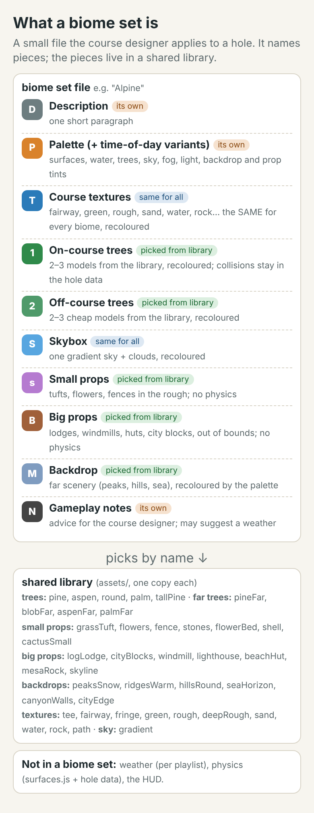

# Pocket Links: art style guide (living document)

Owner: the Artist, with Alexis (owner / game designer). Status: **ART0 round 1 proposal**, nothing below is decided unless marked **(owner)**. Images: `docs/art/biome-sets/`.

— Agent: artist

## 1. Art direction (owner, 2026-11-19)
- **3D, cartoony, light colours, low-poly.** Flat colours **with a stylised texture** (brush dabs, speckles, ripples, facets), never photo-realistic, no realistic trees.
- Reference: Everybody's Golf, for the *idea* (friendly, bright, readable). We copy no look, model, layout or branding from any game or real course. Real places are inspirations only, with invented names.
- **Chibi 3D golfers** later (rigged, standard Mixamo-compatible skeleton for all golfers; rivals are never shown).
- The **pixel / PS1 effect is a player setting**, not the base look. Every asset must read well both clean and pixelated.

### Do / don't
| Do | Don't |
|---|---|
| Big simple shapes, 5-8 sided cones and low icosahedrons, flat shading | Photo textures, normal maps, realistic bark or leaves |
| Two or three shades per object (light / mid / shadow) from the palette | Pure black outlines or pure black shadows |
| Light, slightly warm whites; soft fog that fades the backdrop | Saturated neon colours on surfaces (keep those for the HUD and markers) |
| Keep the course the brightest, most saturated part of the picture | A backdrop brighter or busier than the fairway |

## 2. What a biome set is (owner, DESIGN §8b)
A **file that defines a biome**, which the **course designer applies to a hole** (per hole, owner). It holds:

| Piece | What | Where it comes from |
|---|---|---|
| Description | one short paragraph | the biome's own |
| Palette (+ time-of-day variants) | colours of every surface, water, trees, sky, fog, light, backdrop, props | the biome's own |
| Course textures | fairway, green, rough, sand, water, rock… | **the same for every biome**, recoloured by the palette |
| On-course trees | 2-3 models, recoloured; collisions stay in the hole data | picked from the library |
| Off-course trees | 2-3 cheaper models, recoloured | picked from the library |
| Skybox | one gradient sky + clouds, recoloured | the same for every biome |
| Small props | tufts, flowers, fences spread in the rough, no physics | picked from the library |
| Big props | lodges, windmills, huts, city blocks, mostly out of bounds, no physics | picked from the library |
| Backdrop | far scenery (peaks, hills, sea), recoloured where the asset allows | picked from the library |
| Gameplay notes | advice for the course designer, may suggest a weather | the biome's own |

**Not in a biome set:** weather (per playlist), time of day as a system (it is a palette), physics (`surfaces.js` and the hole data), the HUD.

## 3. How biomes share pieces (proposal: 2 options)
Both options keep **one shared library** (`assets/`, one copy of each model, texture and backdrop). A biome file only names pieces.

- **Option A, pick list (recommended):** every biome file names all its pieces. Nothing is inherited. Easy to read, easy to validate, no surprise when another biome changes. Cost: a few repeated lines between close biomes.
- **Option B, base + variant:** a biome says "based on X" and lists only what it changes. Very short files for close cousins, but editing the base silently changes every variant, and chains get hard to follow.
- **Recommendation: A, plus palette variants.** A palette may be a variant of another palette (`alpine-sunset` = `alpine-day` with sky, fog, light and some surface shades changed). That is how time of day works, and it is the one place where "change the base, update the variants" is wanted.

## 4. Palette rules
### 4.1 Keys every palette defines (same keys in every palette)
- **Surfaces:** `tee`, `fairwayA`/`fairwayB` (mowing stripes), `fringe`, `greenA`/`greenB`, `rough`, `deepRough`, `sand`, `water`, `waterDeep`, `rock`, `path`.
- **Sky / fog / light:** `skyTop`, `skyHorizon`, `cloud`, `fog`, `sun` (sun tint), `ambient` (sky light), `shadow` (shadow tint, the hemisphere ground colour: never black).
- **Backdrop tint:** `backFar`, `backNear`, `backCap` (snow / tops), `backCapShade`.
- **Trees and props tint:** `pine`, `trunk`, `leaf`, `leafAlt`, `trunkAlt`, `wood`, `roof`, `propSnow` (light parts), `propA`/`propB` (flowers), `glass`.
- Hex values for the four palettes are in `docs/art/biome-sets/draft-data.js` and on the palette sheets (images 30-34).

### 4.2 Time of day = a palette variant
No lighting engine: a "sunset" palette changes the sky gradient, fog, sun and ambient tint, the shadow tint, the backdrop tint (pink caps) and shifts the surfaces warmer. It must still pass every readability rule below. A biome lists the palettes it offers (`alpine-day`, `alpine-sunset`), and the hole (or later the playlist) chooses one.

### 4.3 How the backdrop and models are recoloured
- **Backdrops** are built in **tint zones**: far layer, near layer, caps, cap shade. Each zone takes one palette colour, then is **mixed toward `fog`** by its distance (far layer about 40 %, near layer about 20 %). So one snowy-peaks asset works for day and sunset with no new art.
- **Models** (trees, props) use **material slots** named after palette keys (`canopy → pine`, `trunk → trunk`, `walls → wood`, `roof → roof`). Slots are flat colours; light and shade come from the sun / ambient / shadow tints. A model may have a fixed-colour slot only for something that never changes (a window frame).
- **Textures** are **greyscale**: they hold only the pattern (dabs, speckles, ripples, stripes). The palette gives the colour. One set of 10 textures serves every biome (image 04).

### 4.4 Readability rules (gameplay rule: no blind shots)
Checked automatically on every palette sheet (CIE76 ΔE = colour difference, ΔL = lightness difference, which is what colour-blind players and the pixel effect keep):

| Pair | ΔE at least | ΔL at least |
|---|---|---|
| fairway / rough | 15 | 8 |
| green / fairway | 10 | 5 |
| green / rough | 20 | 10 |
| sand / fairway | 20 | 10 |
| sand / rough | 30 | 15 |
| water / fairway, rough, green | 30, 25, 30 | - (water must also have its ripple texture and an edge) |
| aim yellow `#FFD447` on fairway | 20 | |
| warning red `#FF4A3A` on rough | 30 | |
| white aim dots on fairway | 15 | |
| flag red `#FF5A36` on green | 30 | |

Also: the course is always lighter and more saturated than the backdrop; no surface may use the HUD's yellow or red; the putting grid (when shown) must stay visible on both green shades. All four palettes in this round pass. Known weak spot: warning red vs rough has almost no lightness difference (ΔL 1-5), so red/green colour-blind players need the warning's **shape** too (ask: UI designer).

## 5. Phone budget for art (from `reviews/art-tech-lead-followup.md`)
- Tree / rock model **≤ 300-500 triangles** (our models: 100-250), far trees ≤ 50, ≤ 8 tree/rock types per biome.
- Big prop ≤ 1,500 triangles; small prop ≤ 50 (or a flat sprite).
- Textures small and stylised: tiling ground textures **256² (max 512²)**, greyscale.
- Draw calls ≤ 150 per frame: every tree, small prop and far tree type is **instanced** (one call per model part).
- Download per course ≤ 8 MB; graphics memory per hole ≤ 64 MB. No transparent leaves; solid canopies.

## 6. The three starter biomes (round 1 sketches)
| Biome | Palette mood | Trees (on / off) | Big props | Backdrop | Gameplay notes |
|---|---|---|---|---|---|
| **Meadow** (grassland) | warm classic greens, red roofs, pink flowers | round leafy + pine / blobFar + pineFar | windmill | soft round hills | gentle slopes, ponds, open fairways; any weather |
| **Alpine** (mountain) | cool fresh greens, pale sand, blue water; sunset variant | pine / pineFar | log lodge | snowy peaks | creeks, raised tees, elevation; clear, light wind |
| **Island coast** (beach, Hawaii-like) | bright tropical greens, white sand, turquoise sea | palm + round leafy / palmFar + blobFar | beach hut | sea + green volcano | the sea along one side, waste bunkers, dark lava rock; sunny, sea wind |

**Why Alpine for the mountain:** the snowy peaks are the strongest contrast with the Meadow (a different silhouette, not just another green), the existing mountain course already uses pines, and its sunset variant shows the palette-only time of day best. **Ridge country** (Rockies-like: warm palette, aspens, long ridges, far city) stays a *variant note*: it reuses everything of Alpine except the palette, one tree, the backdrop and one big prop (image 14), which is exactly the owner's mix-and-match example.

Later examples (desert, city park, sea cliffs, Georgia pines…) reuse the same library: mostly a new palette plus 1-3 new pieces each (image 03).

## 7. Asset list (round 1, nothing made yet)
| Asset | Used by | Triangles | Notes |
|---|---|---|---|
| 10 greyscale ground textures | all | - | 256², stylised, made by the artist (procedural in the mock-up) |
| Gradient sky + cloud puff | all | ~40 per cloud | one shader, recoloured |
| Pine (3 tiers) | Meadow, Alpine | ~120 | shared |
| Round leafy tree | Meadow, Island | ~180 | shared |
| Palm | Island | ~220 | new |
| pineFar / blobFar / palmFar | as above | 24-40 | cheap far versions |
| Grass tuft, flowers | all | 8-20 | instanced |
| Split-rail fence | Meadow, Alpine | ~24 per section | |
| Windmill | Meadow | ~300 | |
| Log lodge | Alpine | ~400 | snow on the roof is a palette slot |
| Beach hut | Island | ~200 | |
| Backdrops: round hills, snowy peaks, sea + volcano | one each | ≤ 2k each | tint zones |

**CC0 sources that could fit the light cartoony style** (all CC0 1.0, free for commercial use, no attribution required; to be checked asset by asset and recorded in `assets/CREDITS.md` when a file is added):
- Kenney (kenney.nl): Nature Kit, Platformer Kit, Minigolf Kit. CC0.
- Quaternius (quaternius.com): Ultimate Nature, Stylized Nature, Farm and buildings packs. CC0.
- Poly Pizza (poly.pizza): many Quaternius and Kenney models; **check each model**, some are CC-BY (attribution needed).
- ambientCG / Poly Haven: CC0 textures, but photo-based, so only as a starting point to repaint, never as is.
Our own models in Blender remain the default for the hero pieces (pine, lodge), so the look stays ours.

## 8. Mock-up tools (artist only)
`docs/art/biome-sets/mockup.html` renders one hole shaped like `mtn-02` from the draft data (`?biome=grassland|mountain|beach|mountain-warm`, `&palette=`, `&view=approach`, `&hud=0`). `sheets.html` draws the palette sheets and diagrams (`?mode=palette&p=…|textures|structure|options|matrix`). Both are stand-alone pages that use only the vendored Three.js; they are not part of the game.
